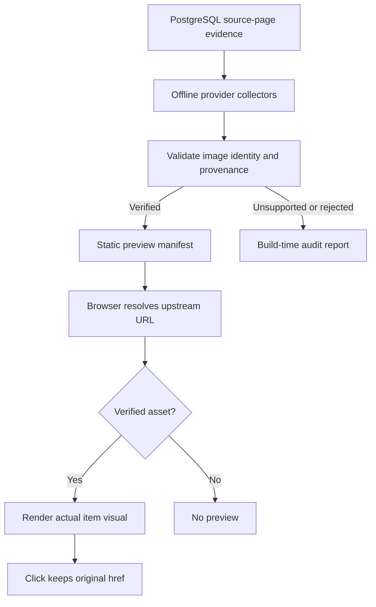

# Component visual previews

**Status:** Architecture for the remaining preview work. No additional providers are approved or implemented by this document. The current uncommitted implementation remains untouched.

## Caller contract

Hovering or focusing a catalog item's internal link or its **Source ↗** link shows **that item**, not the Registry Atlas page, provider documentation chrome, a shared marketing banner, or its install token. Clicking either link follows its original destination. Unsupported components show no preview.

The static site may read a published preview manifest, but must not call PostgreSQL, crawl provider sites, render untrusted component code, or ask a third-party screenshot service for a new image during hover.

## Alternatives considered

| Shape | Ownership | Cost and failure mode | Decision |
| --- | --- | --- | --- |
| UI hardcodes provider URL formulas and a literal index | Browser application | Every provider addition changes application code; rules can claim unverified media | Interim implementation only |
| Hosted dynamic screenshot or live component renderer | Runtime service | Ongoing request limits, service cost, unrelated page screenshots, untrusted code | Reject |
| Offline resolver and provenance manifest | Build-time evidence pipeline | Bounded refresh, static lookup, no runtime provider query except the chosen image | **Target** |

## Domain

The evidence is keyed by a canonical **upstream source URL**, not by an Atlas route, display name, or generated slug. One media asset must be attributable to exactly one catalog item (shared image hashes or identical source URLs require rejection or manual review).

Proposed discriminated types:

```ts
type PreviewEvidence =
  | {
      state: 'verified';
      sourceUrl: string;
      mediaUrl: string;
      format: 'svg' | 'png' | 'webp' | 'jpeg' | 'avif' | 'gif';
      kind: 'icon-art' | 'component-specimen' | 'block-screenshot';
      provider: string;
      method: 'provider-pattern' | 'page-metadata' | 'explicit-asset';
      observedAt: string;
      mediaDigest?: string;
    }
  | {
      state: 'unsupported' | 'rejected';
      sourceUrl: string;
      reason: string;
      checkedAt: string;
    };
```

Publish **only verified** records into a compact manifest indexed by source URL. Keep rejected/unsupported records in build-time evidence for audit and incremental refresh. Never silently fall back to a site screenshot.

## Ownership and boundaries

| Owner | Responsibility |
| --- | --- |
| PostgreSQL source-page manifest | Authoritative upstream URL and item identity; not a source of arbitrary images |
| Offline collector under `scripts/` | Enumerate current sources, fetch provider metadata with bounded concurrency and timeouts, record provenance and failures |
| Provider policy module | Provider-specific extraction, safe URL transformations, asset-specific proof rules, and versioned acceptance fixtures |
| Verification step | Check MIME, redirects, source-to-media identity, duplicate/shared images, and representative rendered visuals; reject ambiguous results |
| Generated static manifest under `public/data/` | Small runtime lookup table; generated from verified evidence, separate from the catalog's core JSON |
| `catalogLinkPreview.ts` | Presentation only: lookup, hover/focus, position, load/error/cleanup, original-link behavior, and responsive constraints |

Use a build-time data adapter rather than importing a large generated map into the UI source bundle. The existing `upstreamVisualPatterns.ts` and `aceternityVisualEvidence.ts` become migration inputs; keep their known-good cases until a manifest proves equivalence, then remove superseded branches rather than maintaining two authorities.

## Main flow



## Asset rules

1. Accept a direct asset only when it belongs to the exact item and is served as a supported image. An image URL with a valid extension but unrelated content is not enough.
2. Accept predictable provider transformations only after checking multiple different items and their actual rendered media. Verify route variants independently.
3. Accept page metadata only when it points to a provider-controlled, item-specific asset. Reject reusable Open Graph banners, product ads, 404 placeholders, and provider landing screenshots.
4. Do not infer media from Atlas routes, registry names, item JSON files, or screenshot services.
5. Permit animated media only as source-provided media, not through execution of component JavaScript in Atlas.
6. Validate redirects and hostnames at the network boundary. Reject private-address targets, unsafe protocols, oversized responses, disallowed MIME, and untrusted SVG content if it will be embedded inline. Prefer ``, never `innerHTML` with remote SVG.
7. Respect upstream rights and request limits. Cap concurrency and refresh deltas instead of repeatedly fetching the entire corpus.

## UI contract

- The **Source ↗** external anchor and the item's internal anchor keep their original `href`, focus, keyboard, and click semantics.
- A preview is supplementary. No verified asset means no tooltip, not an Atlas detail-page preview.
- Focus displays the same asset as hover. Escape, focus out, leaving the trigger, route changes, and scrolling close it. Maintain and restore prior `aria-describedby`.
- Narrow/touch layouts do not show a pointer-only floating card. Honor reduced motion. Keep previews inside the viewport and avoid pointer interception.
- A failed image closes the preview and does not alter navigation.
- Repeated route rendering must not install duplicate event listeners, observers, or stale closures.

## Delivery sequence

1. **Freeze behavior.** Add black-box tests for actual .NET SVG, Shadcnblocks block, ReUI component, Aceternity metadata, unsupported Space UI, keyboard, mobile, error cleanup, and original link navigation.
2. **Measure coverage.** Generate deterministic per-provider counts from the current source-page manifest. Record eligible, verified, rejected, unsupported, stale, and missing. Do not equate a matching URL pattern with a successful preview.
3. **Collect evidence.** Turn one-off Aceternity collection into a resumable bounded provider collector. Keep exact evidence and rejection reasons. No runtime crawling or vendor API quota.
4. **Replace ad-hoc lookup.** Generate a versioned static manifest, read it once, and preserve existing validated visual cases. Remove the giant source literal and obsolete branching after parity checks.
5. **Close UI lifecycle.** Verify focus/pointer exit, observer cleanup, dynamic rerenders, network failures, and narrow layouts in a real browser.
6. **Roll out by provider.** Require several distinct item images, negative fixtures, and browser proof before enabling each new pattern. Publish coverage reports. Never claim all 91,716 items are covered without measuring each accepted asset.

## Acceptance

- Every preview shown is the actual upstream component visual or a documented screenshot of that exact component.
- Unsupported providers render no preview; all links still navigate.
- Positive and negative provider fixtures pass offline.
- E2E proof captures both action and resulting image state, and checks original-link destinations and touch/keyboard behavior.
- Provider evidence can be regenerated without overwriting manual exceptions silently.
- The production frontend has no database, image-capture API, or model dependency for hover previews.
- Security, accessibility, responsive, performance, dependency, and data-validation checks remain part of `pnpm verify`.
- A report lists verified, unsupported, and unverified counts; no completion claim based only on URL matches.

## Risks to prove, not assume

| Risk | How to disprove it |
| --- | --- |
| Provider URL pattern returns the same branded banner for every item | Compare distinct item pixels/identity with the upstream demos |
| CDN images change or expire | Recheck a bounded sample and capture refresh failures without hiding the previous good state |
| Preview controller retains listeners across rerenders | Navigate repeatedly and assert only one tooltip and clean dismissal |
| External media blocks hotlinking | Test loading in the browser (not just HTTP HEAD) and preserve the source link on failure |
| Third-party source imports leak private or untrusted URLs | Run URL-policy and fixture tests at extraction and rendering boundaries |
| Generated manifest bloats the JS bundle | Keep the evidence as a separate static asset and measure transfer size |
| Static corpus drifts from PostgreSQL | Tie generated preview manifest version to the current source-page projection |
