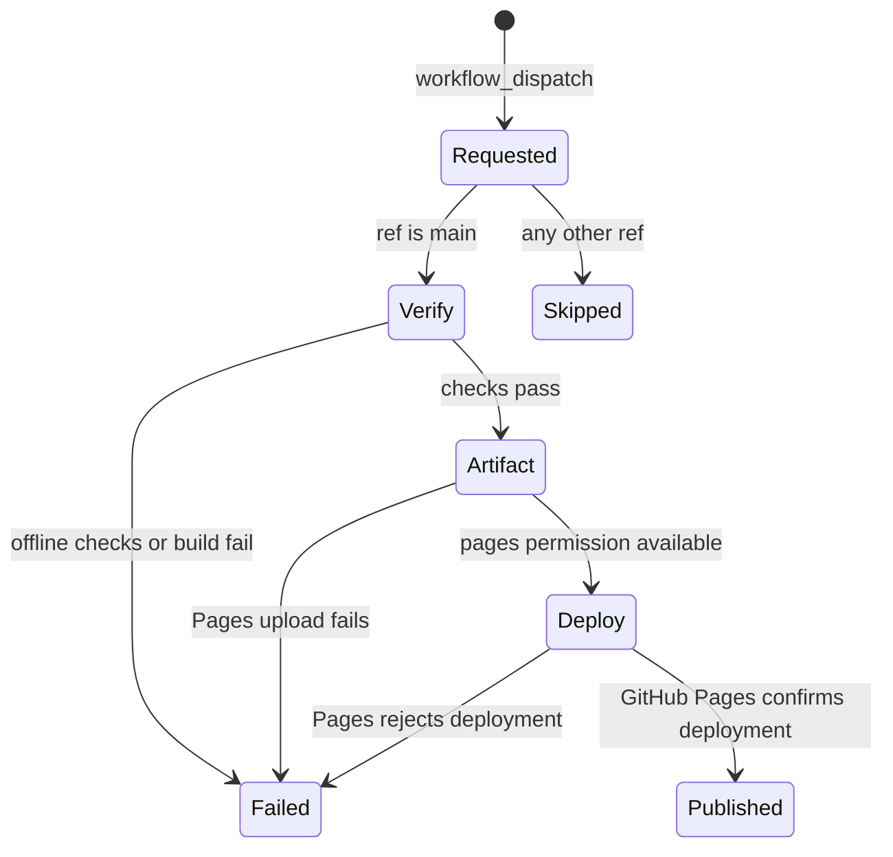

# Registry Atlas Pages release

Manual publishing is the only release trigger. The existing pull-request and `main` CI checks remain unchanged. The release job restores the reviewed public-data fixture, verifies the exact release build, then publishes `dist/` via GitHub Pages. PostgreSQL stays on the trusted workstation.

The Pages environment restricts deployments to `main`. The verification job receives only repository-read access; the deployment job receives Pages-write and OIDC-token permissions. Build inputs come from `tests/fixtures/ci-runtime.tar`, so public workflows cannot open the local PostgreSQL credential files. To refresh published catalog data, explicitly generate and review the trusted local runtime snapshot and update the pinned fixture with `mise run ci:fixture` before committing it.

## Release

Open **GitHub Actions → Deploy GitHub Pages → Run workflow**, select `main`, then follow the **Verify and package Pages** and **Publish GitHub Pages** jobs. Or use `gh workflow run deploy-pages.yml --ref main`. The workflow does not deploy automatically on push and does not regenerate data from PostgreSQL. The release URL comes from the `github-pages` deployment environment.
