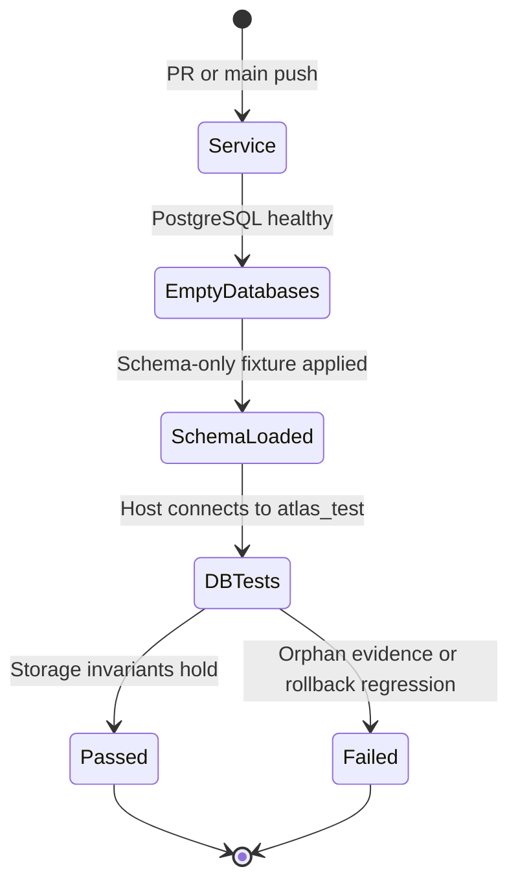

# Isolated PostgreSQL CI lifecycle



GitHub-hosted Linux runs a disposable PostgreSQL 18 service with test-only credentials. It loads a schema-only fixture from the isolated `atlas_test` database, then runs selected real database tests. No authoritative records, backup data, or developer credentials leave the workstation. The existing offline CI verification job remains independent.

The fixture is a **schema-only** PostgreSQL 18 `pg_dump` with owner, ACL, comments, and table contents omitted. Refresh it after an intentional schema migration with:

```bash
docker exec registry-atlas-local-database-1 pg_dump -U atlas -d atlas_test --schema-only --schema=atlas --no-owner --no-acl --no-comments --restrict-key=AtlasCISchemaFixture | sed '${/^$/d;}' > tests/fixtures/atlas-schema.sql
```

Run `mise run test:postgres` against an isolated `atlas_test` database. CI's job initializes `atlas` and `atlas_test` from the fixture and then runs exactly the same test command. The existing `verify:local` job continues running its offline test suite without database credentials.
