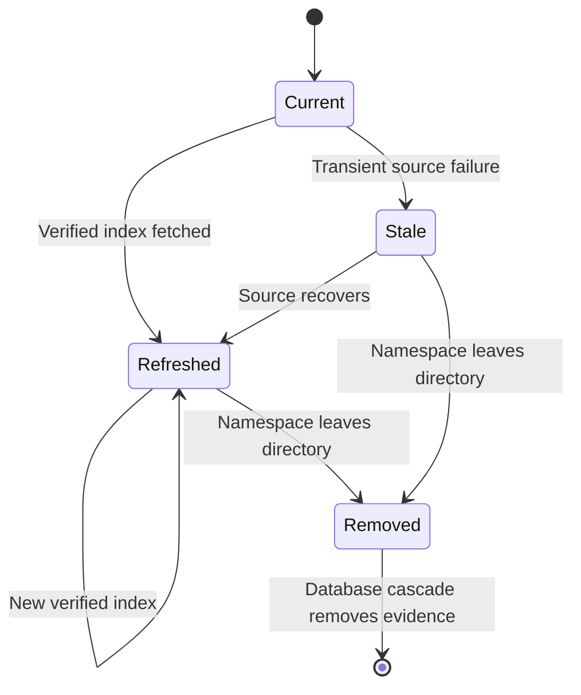

# Registry catalog evidence lifecycle

Registry namespace identities come from the official directory. Catalog evidence cannot outlive its namespace.

When the directory is refreshed, retained registry identities are updated in place; removed identities are deleted. A database foreign key cascades the removal into catalog evidence. Data insertion for a nonexistent registry fails. The official sync still preserves catalog evidence on upstream errors for _current_ registries. The writer updates the directory and evidence in existing database transactions. This prevents the removed-registry evidence regression from `027b8d0` even if the caller forgets to filter stale entries.
