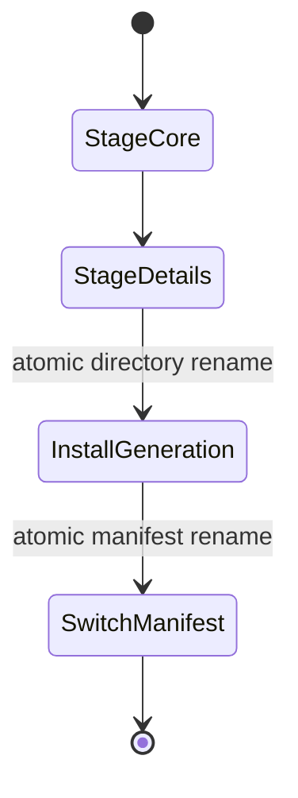

# Runtime-generation consistency

The browser chooses a generation once per fetch function, then reads catalog and lazily loaded details from that pinned generation. The runtime publisher first writes both files to a private directory, atomically installs the immutable generation, then atomically changes the manifest pointer. The formal model checks publication order and client consistency for two generations and one client across all action interleavings.

The historical bug in commit `255d260` allowed clients to observe catalog and detail data from different snapshots. The model includes deliberately broken publication and client variants to prove the invariant checks detect that mistake. This models file visibility and client selection, not disk corruption or network latency.

Run `mise run test:formal` to exhaustively explore the safe state graph and require two historical mutant configurations to produce counterexamples. The model uses official TLC 2.19 from the TLA+ v1.7.4 release, with a pinned SHA-256 checksum, and GitHub Actions runs it in an independent Java 21 job. Real filesystem and browser-loader tests remain responsible for executable behavior.
