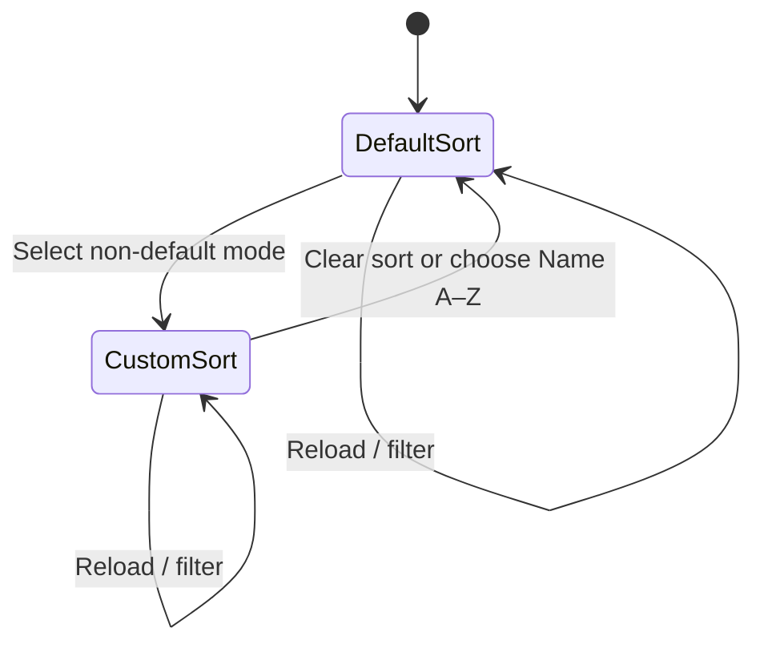

# Catalog sort select filter

Reference: https://registry.soldevelo.com/components/openlmis-select-filter

## Desktop journey

Replace the six-button results toolbar with one compact select: **Sort by: Name A–Z**.
Open it, choose one of the existing six modes, and show the chosen label.
When a non-default mode is chosen, a separate clear button resets the sort to Name A–Z without clearing search or filters. Keep sidebar sorting and URL state synchronized.

Use the reference component's labeled trigger and sibling clear action, ported to the existing DOM renderer with a native select and progressive picker styling. Keep the existing sort enum and shared shell transaction. No React/Base UI runtime migration or new packages.
