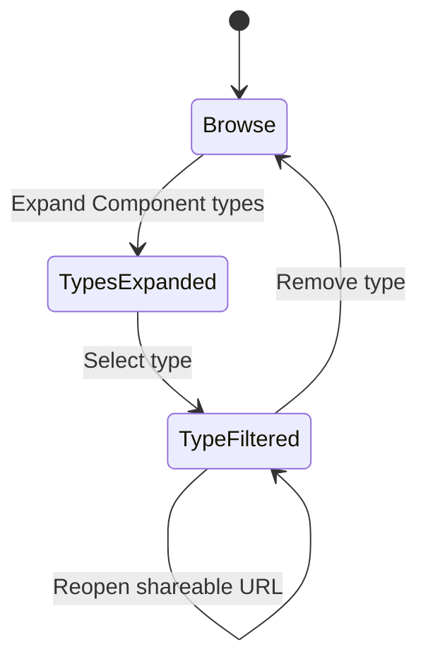

# Registry Atlas: catalog-backed component facets

Date: 2026-11-23
Status: implementation

## Observed defect

The approved canonical taxonomy controls filterability, but the catalog contains many unclassified entries. The previous Common types controls merely launch broad text searches, including unrelated descriptions. This makes common type filtering depend either on a classification-publishing process or on an inaccurate search workaround.

## User journey / prototype

1. Open Components; expand **Component types** in the existing sidebar.
2. Each available type shows a catalog-backed count, including unclassified items.
3. Click **Avatar**; the URL becomes `?componentType=avatar`, the results contain only items whose own names/titles/source categories match the type, and unrelated descriptions do not qualify.
4. Continue searching or changing Registry, Sort or other filters without losing the type selection; click its applied-filter chip to remove it.
5. Adding another type requires only one descriptor in the common type catalog; no database changes, approval step, taxonomy version change or runtime republishing.

## Architecture decision

- The **browse type registry** (`core/catalogComponentTypes.ts`) owns labels, stable IDs and matching terms. Source item metadata determines matches; reviewed canonical classifications remain independent provenance.
- The catalog query owner evaluates type membership from item name/title/source categories, not descriptions or broad text search, and calculates truthful facet counts from the same function.
- URL parse/serialize stores `componentType`; shell state, result cards, sidebar and applied filters all consume the same state.
- Preserve the existing versioned taxonomy for reviewed canonical categories; it no longer blocks adding new browse types.
- A type definition without any matching items remains hidden until the catalog contains evidence. Existing native summary/buttons provide keyboard support and state.

## Verification

- Test-first: an unclassified Avatar item must be filterable, a text-only mention must not match, facets must count real items, URL must round-trip, selection must preserve the search input.
- Check targeted tests, TypeScript, Oxlint, formatting, product contract and real desktop browser.
