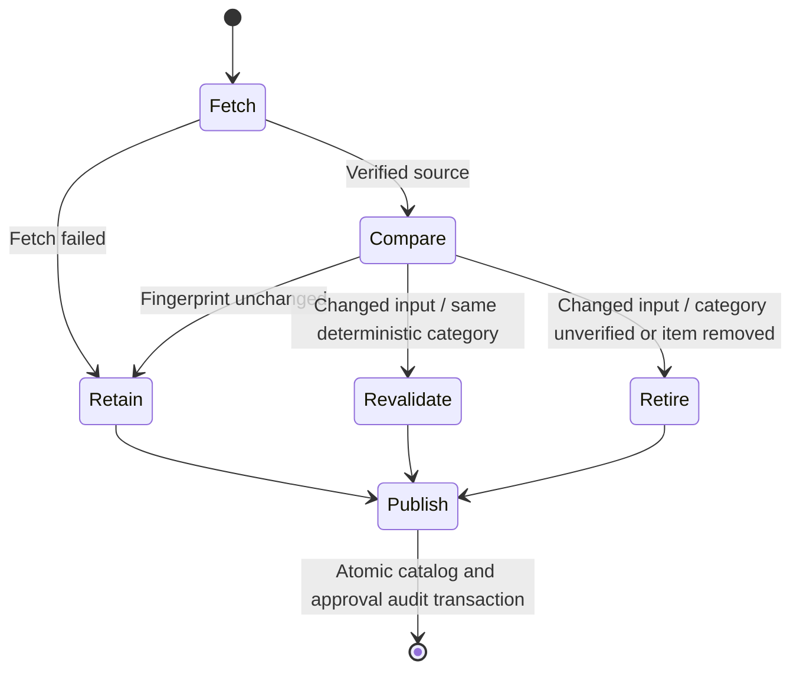

# Automatic classification reconciliation

Normal registry and catalog-evidence sync must use the same deterministic reconciliation policy as the targeted queue repair. A verified changed input is revalidated only if the exact approved category and path are independently reproduced. Otherwise retire the approval with audit provenance for future review. A failed fetch retains its previous evidence and does not renew or retire its approval.

The repair path for existing drift remains the existing read-only reconciliation plan, verified backup, then atomic apply. No automatic human approval, model call or fingerprint bypass.
