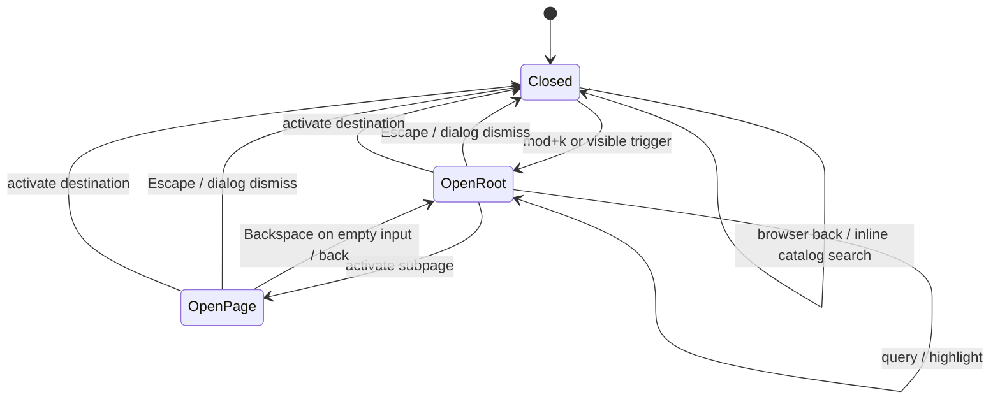

# Registry Atlas command palette and sidebar design

**Status:** Approved 2026-11-21; implementation lives on `atlas-command-ui` pending integration.
**Date:** 2026-11-21
**Scope:** Desktop browser application. Preserve existing responsive and mobile-sidebar behavior; no new mobile workflow.
**Related plan:** [implementation plan](../plans/2026-11-21-command-palette-and-sidebar.md).

## Intent

Add Ctrl+K navigation and reorganize the existing left sidebar and component-group presentation using Hairline UI's documentation library as the visual reference. Find a specific component, browse an existing category, or jump to a source library with fewer steps while preserving Registry Atlas's evidence-backed catalog rules.

## Evidence and existing behavior

- `index.html:93-110` renders a live `#searchInput` with a visible `/` hint, but the inspected shell has no corresponding slash or Ctrl+K shortcut. `src/registry-explorer/ui/shell.ts` writes the text into `AppState.searchTerm` and the route query.
- `index.html:111-157` owns primary routes (Featured, Authors, Libraries, Collections asset kinds, Compare); `createShellSidebar` in `ui/shellSidebar.ts` renders route-specific browse facets below it.
- `ui/catalogSidebarNavigation.ts` derives nested canonical categories and counts from `CatalogTaxonomy` and `CatalogFacetSummary`. Expansion is separate from selection; `tests/grouped-sidebar.e2e.ts` verifies this. `src/registry-explorer/core/catalogPolicy.ts` and the loaded snapshot own taxonomy, not the visual renderer.
- `src/registry-explorer/ui/catalogComponentsView.ts` renders featured discovery bands, catalog cards, a results toolbar, and progressive loading. `core/catalogRoutes.ts` owns canonical URLs. Navigation, history, focus restoration and filter state flow through `ui/shell.ts`, `ui/shellState.ts` and `ui/browseRouteState.ts`.
- `DESIGN.md` requires the vanilla TypeScript DOM renderer, existing core/data/UI separation, StyleX component styling and dark tokens. React is 18.3.1 in package.json, so a React 19 conversion is outside this change.
- Existing desktop navigation widths: 190–440px; each panel scrolls independently. Keep the app's current FHD verification baseline, existing browser history and real-data counts.

## Reference interpretation

**Hairline UI** [component library](https://hairlineui.com/ui) shows a fixed search control above a long, vertically scrollable grouped sidebar: section captions (Getting started, Blocks, Library), live group counts, concise leaf rows, and a content area that gives each component group a clear identity. [Hairline command palette](https://hairlineui.com/ui/command-palette) uses a shortcut, fuzzy lookup, nested choices and clear keyboard guidance.

**Reuse the information hierarchy and density, not Hairline's React component code.** Catalog labels, group membership, counts and source identities must come from Atlas's validated snapshot and canonical taxonomy. This is a reference exemplar, not a data import, new source-of-truth taxonomy, or authorization to copy its branding.

**UI SDK:** use `@ui-sdk/web/command` and `@ui-sdk/web/dialog` alongside `@ui-sdk/core`, which support Vite + native DOM with `<ui-command>`, `<ui-dialog>`, `shortcut="mod+k"`, grouped commands, fuzzy ranking, and page navigation. Do not install `@ui-sdk/react`; do not use Hairline's separate command palette implementation. Verify installed beta exports and behavior before writing integration code.

Sources: [UI SDK Web installation](https://ui-sdk.dev/docs/web-components/installation), [Command](https://ui-sdk.dev/docs/web-components/components/command), [Dialog](https://ui-sdk.dev/docs/web-components/components/dialog), [Hairline UI](https://hairlineui.com/ui).

## Proposed user journey and text prototype

1. A user opens Components. The desktop sidebar shows a compact brand, existing catalog search input, a clearly operable Ctrl+K shortcut button, a few primary destinations, then a scrollable **Library** grouping with counts. The current category remains visibly selected.
2. They expand **Navigation**. The group expands beneath its row without filtering results; selecting **Navbar** applies the existing canonical taxonomy filter and shows its existing source-backed cards and result count.
3. They press Ctrl+K anywhere in the Atlas document, including when the catalog search has focus. A labeled palette opens at the top-center; its input is focused. The existing catalog query stays unchanged until the user chooses a result.
4. They type `navbar`. UI SDK fuzzy-matches existing asset routes and categories, with the full name and registry/source context. Arrow keys move the highlight; Enter opens a selected item or category. The palette closes, the correct route and history are updated through existing shell methods, and focus returns sensibly to the destination.
5. They can pick an explicit **Search catalog for “navbar”** command instead of a single result to apply Atlas's existing full-results query.
6. Escape closes the dialog; normal browser back restores the prior route and filters. The existing inline Search catalog input still live-filters the catalog independently.

```text
┌─ Registry Atlas ──────────────┬──────────────────────────────────────────┐
│ R  Registry Atlas     Setup   │ Components                 [Grid] [List]│
│ [Search catalog…]  [Ctrl K]   │  Catalog count from current snapshot    │
│                              │                                          │
│ EXPLORE                      │ Group / category context when selected   │
│   Featured                   │ [Current query and applied filter chips] │
│   Libraries                  │                                          │
│   Authors                    │ [Existing card] [Existing card] ...      │
│   Compare                    │                                          │
│                              │ [Existing progressive results]           │
│ LIBRARY                      │                                          │
│   Components              #  │                                          │
│   Blocks                  #  │                                          │
│   Pages                   #  │                                          │
│   Templates               #  │                                          │
│   Themes                  #  │                                          │
│   Icons                   #  │                                          │
│                              │                                          │
│ COMPONENT GROUPS             │                                          │
│ ▾ Navigation              #  │                                          │
│   Navbar                   # │                                          │
│   Menu                     # │                                          │
│ ▸ Controls                 #  │                                          │
│ ▸ Layout                   #  │                                          │
│                              │                                          │
│ [sidebar independently scrolls]│                                       │
└──────────────────────────────┴──────────────────────────────────────────┘

Ctrl+K:
       ┌──────── Search components, libraries or actions ────────┐
       │ [navbar                                            ]   │
       │ COMPONENTS                                              │
       │   Navbar                            Library / Component│
       │ GROUPS                                                  │
       │   Navigation / Navbar               Filter components  │
       │ SEARCH                                                  │
       │   Search catalog for "navbar"       All matching items │
       │ ↑ ↓ navigate     Enter open     Esc close               │
       └─────────────────────────────────────────────────────────┘
```

The counts and labels above are placeholders: render only entries and totals found in the actual snapshot. Showing categories with no matching source-backed members is unnecessary unless they are actively selected and need contextual visibility.

## Interaction statechart

Use this statechart as the behavioral model before implementation. UI SDK owns keyboard and dialog mechanics; Atlas owns route and filter commits.



Domain transition on destination activation: `command value -> resolve canonical route/filter action -> existing navigate or setState -> close dialog`. Do not create a second history owner, query parser, taxonomy, ranking algorithm or focus-restoration system.

## Contract and ownership

| Concern                                                                              | Owner                                                                         | Expected result                                                                |
| ------------------------------------------------------------------------------------ | ----------------------------------------------------------------------------- | ------------------------------------------------------------------------------ |
| Command input, fuzzy scoring, active option, keyboard events, dialog focus/dismissal | UI SDK Web + Core                                                             | Consistent accessible Ctrl+K behavior                                          |
| Command candidates, unique stable IDs, source context, canonical item identity       | Atlas catalog index, policy and a small UI adapter                            | No made-up search results or ambiguous same-name components                    |
| Navigation and URL history                                                           | Existing `navigate`, `setState`, `catalogRoutePath`                           | Same route, query and Back/Forward behavior as manual navigation               |
| Category membership and counts                                                       | Existing `CatalogPolicy`, facet summary and item index                        | Same taxonomy and accurate count units across sidebar and content              |
| Sidebar expand/collapse                                                              | Existing `<details>`, `expandedCategoryIds` / `collapsedCategoryIds`          | Expansion never selects a filter                                               |
| Visual layout                                                                        | Existing StyleX tokens, component-owned StyleX and split-panel infrastructure | Hairline-like hierarchy without new global CSS or layout engine                |
| Data safety                                                                          | `escapeHtml`, verified route builders, documented source URL rules            | Display names/URLs cannot become raw executable markup                         |
| Main component groups                                                                | Existing routes and `renderCatalogComponents`                                 | Group heading/description when selected; no duplicate cards or fake categories |

The command palette is a **navigation overlay**, not a second persistent search/filter state. Inline catalog search remains the current source of truth for result filtering. The palette's query stays transient until an explicit command commits it. Reuse existing app objects and avoid an extra command-store.

## Visual design rules

- Fixed upper shell: brand and single inline catalog search field with small Ctrl+K trigger. Avoid a second large search box on the sidebar.
- Sticky primary section labels above a **single** internally scrolling category/group area; keep `min-height: 0`, existing split-panel widths, and explicit visible scroll cues. Avoid nested independent scroll zones that obscure navigation.
- Hairline-like group headings: quiet uppercase or small-caps headings, thin separators, compact rows, right-aligned numeric counts, one clear active/hover state, restrained disclosure arrows.
- Separate **Explore** destinations from **Library** asset kinds; place **Component groups** beneath Library while browsing components and applicable contexts. For registry views, retain registry-specific asset counts and facets; for Compare and Setup, do not show irrelevant category groups.
- Keep source-backed ordering and meaningful full labels. Text truncation requires accessible full name. Counts must distinguish **items** from **registries**; do not compare unlike count types.
- Centered palette with constrained list scrolling and visible keyboard help; use UI SDK focus and dismiss behavior. No unapproved motion library or app-wide design-token replacement.
- Card grouping in the main area should start with the current selected group heading, a valid breadcrumb, count, and existing grid/list cards; preserve existing discovery bands when unfiltered. Do not re-render all catalog items into giant sections or break progressive loading.

## Alternatives and recommendation

1. **Replace the entire app shell with React + UI SDK React.** Rejected: violates `DESIGN.md`, expands scope, forces React 19 and frontend migration.
2. **Install Hairline's React command palette/tree and copy its sidebar structure.** Rejected: competing keyboard/selection contract, extra React integration, imported vendor taxonomy not aligned with Atlas.
3. **Use UI SDK Web for the overlay and evolve existing TypeScript/StyleX sidebar.** **Recommended.** Preserves domain/navigation behavior and provides the desired design with the smallest dependency change.

One deliberate tradeoff: keep the live inline catalog search next to a smaller Ctrl+K trigger, rather than replacing it with a palette-only search. This preserves the proven filter workflow; review the arrangement in an FHD mockup before implementation.

## Success and acceptance

- Ctrl+K (or Cmd+K) works from existing Atlas shell focus; native browser shortcuts in embedded third-party iframe previews remain outside Atlas control.
- Opening/closing is keyboard-accessible and returns focus. No event is registered twice after SPA rerenders; composing IME Enter must not activate a command accidentally.
- Matching commands use UI SDK fuzzy behavior; search suggestions and item/category actions carry real indexed identities, accessible context and deterministic choices.
- Opening a component or group reaches the same canonical URL and filter state as clicking it normally. Back, Forward and reload restore the same selection. Duplicate names in different registries remain distinct.
- The sidebar shows Explore, Library and applicable Component groups with correct labels/count units. Expanding a branch does not change results; selecting a child does.
- FHD 1920×1080: sidebar 190–440px remains resizable, no page-wide overflow, no clipped palette, and independent scrolling; reduced motion, focus-visible and dark-mode contrast checked.
- Mobile behavior already present remains unchanged. No new mobile UI is planned.
- Existing browse, Compare, setup/install queue, verified original links, grids, previews, and progressive results remain functional.

## Review and implementation gate

This document is the proposed journey and architecture for review; the implementation plan lists independently testable changes. Confirm the single inline search + Ctrl+K trigger arrangement and the **Explore / Library / Component groups** sidebar grouping before implementing.

## Modern Web Guidance

Consulted `dialog`, `accessibility`, `content-first-noise-reduction`, `scrollability-affordance-hints`, `accessible-web-components` and `ime-safe-enter-submit`. Applicable guidance: preserve native semantics and meaningful focus, keep persistent navigation compact, do not hide scrolling, and avoid custom-element ARIA relationships crossing shadow boundaries. During integration, test UI SDK's own keyboard implementation before adding any listener or fallback.
